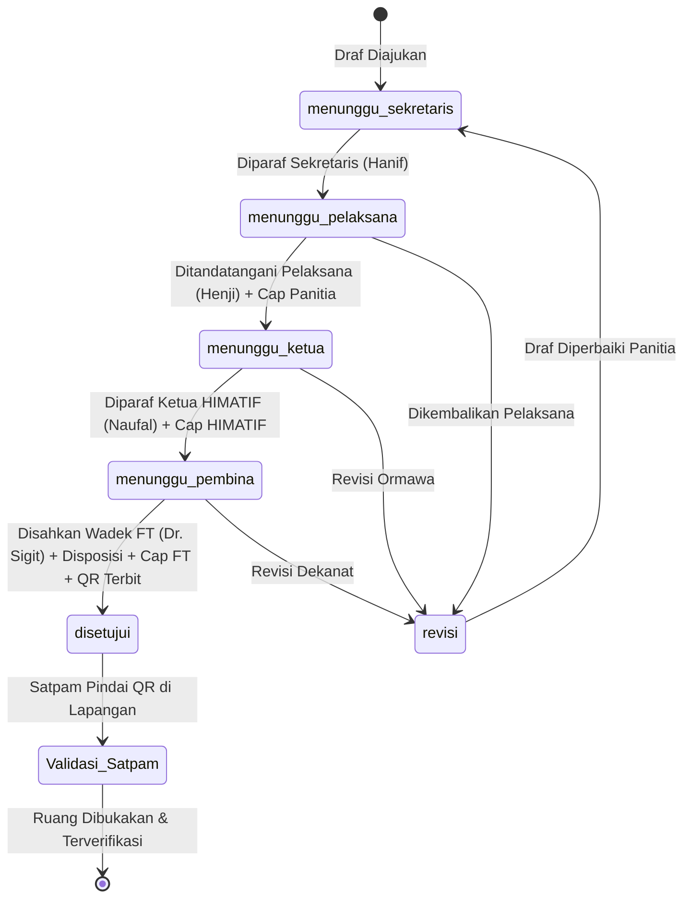

# ValidIn - Sistem Pengesahan & Validasi Dokumen Digital Organisasi Kampus
### Edisi Khusus: Himpunan Mahasiswa Teknologi Informasi (HIMATIF) &bull; Fakultas Teknik Universitas Tidar (UNTIDAR)


ValidIn adalah platform tata kelola dan pengesahan surat permohonan peminjaman fasilitas (gedung/kelas FT 03, alat/sound system) serta perizinan kegiatan organisasi mahasiswa di lingkungan Fakultas Teknik Universitas Tidar. Dilengkapi dengan **Auto-generate Cryptographic QR Code Stamping** dan **Catatan Disposisi Pejabat Fakultas** untuk verifikasi izin seketika di pos Petugas Keamanan (Satpam) kampus tanpa perlu login.

---

## 📌 Latar Belakang & Masalah (5 Whys)

1. **Gejala:** Mahasiswa dan panitia kegiatan bolak-balik ke ruang dosen dan pos satpam, proses pengesahan surat peminjaman gedung/kelas memakan waktu lama (>3 hari), dan berkas fisik rawan tertumpuk atau terselip.
2. **Mengapa 1?** Tanda tangan, paraf, stempel ormawa, dan lembar disposisi izin ruangan masih dilakukan secara manual pada kertas fisik secara berantai.
3. **Mengapa 2?** Belum ada sistem terpusat yang memfasilitasi alur bertingkat antara Sekretaris, Ketua Pelaksana, Ketua Himpunan, hingga Wakil Dekan.
4. **Mengapa 3?** Proses persuratan kampus masih bergantung pada paradigma dokumen kertas (*paper-based*).
5. **Akar Masalah:** Ketiadaan platform digital terpadu yang memfasilitasi verifikasi berjenjang autentik berstempel resmi dan pembuktian legalitas cepat yang dapat divalidasi langsung oleh Satpam melalui pemindaian QR Code.

---

## 👥 Struktur Peran & Pejabat Resmi UNTIDAR

Sistem ValidIn mengadopsi struktur pengesahan resmi 4 pejabat berjenjang sesuai tata persuratan Fakultas Teknik Universitas Tidar:

| No | Pejabat / Peran | Identitas Resmi | Platform | Wewenang & Tanggung Jawab Utama |
| :-: | :--- | :--- | :--- | :--- |
| **1** | **Sekretaris Panitia** | **Hanif Abdillah Alatas**<br>(NPM. 2420506041) | Web & Mobile | &bull; Menyusun draf surat permohonan peminjaman ruangan/alat.<br>&bull; Mengisi rincian hari, jam, fasilitas, dan contact person panitia.<br>&bull; Membubuhi paraf draf kesekretariatan awal. |
| **2** | **Ketua Pelaksana** | **Emannuel Henji Pratama Putra**<br>(NPM. 2505060012) | Web & Mobile | &bull; Bertindak selaku penanggung jawab operasional kegiatan.<br>&bull; Menandatangani berkas permohonan resmi panitia.<br>&bull; Membubuhi Cap Panitia Pelaksana DigitalWave. |
| **3** | **Ketua HIMATIF UNTIDAR** | **Naufal Miftakhul Siddiq**<br>(NPM. 2440506060) | Panel Web | &bull; Meninjau kepatuhan agenda terhadap program kerja ormawa.<br>&bull; Membubuhi paraf mengetahui Ketua Himpunan.<br>&bull; Membubuhi stempel resmi lingkaran ganda biru HIMATIF UNTIDAR. |
| **4** | **Wakil Dekan FT UNTIDAR**<br>(Bidang Akademik & Kemahasiswaan) | **Dr. Sigit Iswahyudi, S.T., M.T.**<br>(NIP. 197510302021211005) | Panel Web | &bull; Menuliskan catatan disposisi resmi pejabat (instruksi satpam/sarpras).<br>&bull; Memberikan tanda tangan pengesahan akhir tingkat fakultas.<br>&bull; Membubuhi stempel resmi lingkaran merah Fakultas Teknik.<br>&bull; Mengaktifkan QR Code validasi untuk keamanan kampus. |
| **5** | **Petugas Keamanan (Satpam) & Sarpras** | Unit Keamanan Kampus Tuguran UNTIDAR | Portal Publik Web (Tanpa Login) | &bull; Memindai QR Code surat pemohon untuk memeriksa keaslian izin.<br>&bull; Membaca instruksi disposisi Wadek FT (ruang yang boleh dibuka).<br>&bull; Mencetak kartu izin akses ruangan kegiatan. |

---

## 🔄 Alur Pengesahan Berjenjang (*State Machine 5 Tahap*)

Alur status surat permohonan dirancang berurutan dengan riwayat audit trail lengkap:



### Rincian Perubahan Status:
1. `menunggu_sekretaris`: Draf surat baru dibuat, menunggu pemeriksaan redaksional dan paraf dari Sekretaris Panitia.
2. `menunggu_pelaksana`: Surat telah diparaf sekretaris, menunggu tanda tangan komitmen dari Ketua Pelaksana kegiatan.
3. `menunggu_ketua`: Berkas panitia telah lengkap, menunggu peninjauan dan pembubuhan stempel resmi dari Ketua HIMATIF UNTIDAR.
4. `menunggu_pembina`: Berkas ormawa telah lolos, menunggu disposisi instruksi satpam dan pengesahan dari Wakil Dekan Fakultas Teknik.
5. `disetujui`: Surat resmi sah tingkat fakultas. Sistem otomatis menerbitkan token QR Code UUID unik dan sidik jari SHA-256 yang siap dipindai oleh Satpam kampus.
6. `revisi`: Surat dikembalikan dengan catatan perbaikan dari pejabat peninjau.

---

## 🏛️ Arsitektur Sistem Monorepo

```
+-----------------------------------+       +-----------------------------------+
|   Panitia (Sekretaris / Pelaksana)|       |     Ketua HIMATIF / Wadek FT      |
|    (Flutter Mobile & Portal Web)  |       |   (Laravel Blade / Livewire Web)  |
+-----------------+-----------------+       +-----------------+-----------------+
                  |                                           |
                  | HTTPS / REST API                          | Web Session (SSO)
                  v                                           v
+-------------------------------------------------------------------------------+
|                             Laravel Backend Service                           |
|  - Auth & Role Management (Sanctum)                                           |
|  - 4-Tier Hierarchical State Machine Controller                               |
|  - Dual Emblem Letterhead & Matrix Signature Engine                           |
|  - Handwritten-Style Disposition Injector (Instruksi Satpam)                  |
|  - Cryptographic QR Code Tokenizer (UUID v4 / SHA-256 Digest)                 |
+---------------------------------------+---------------------------------------+
                                        |
                                        v
                            +-----------------------+
                            |     MySQL Database    |
                            +-----------------------+
```

---

## 💡 Strategi Arsitektur Sinergi Web & Mobile (Flutter)

Sesuai pembagian peran di atas, pembagian platform yang diterapkan pada proyek ValidIn adalah:

### 1. Portal Web (Laptop / PC)
- **Fokus Utama:** Digunakan oleh **Sekretaris Panitia (Hanif Abdillah Alatas)** sebagai *single point of entry* untuk menyusun draf surat permohonan, mengisi rincian fasilitas (gedung/alat), dan mengunggah berkas PDF (karena pengetikan rincian dokumen dan manajemen berkas jauh lebih cepat, presisi, dan nyaman melalui perangkat desktop/laptop).
- **Akses Tambahan Pejabat:** Pejabat peninjau (**Ketua HIMATIF** dan **Wakil Dekan FT**) dapat mengakses meja disposisi melalui browser saat berada di meja kerja kantor dekanat.

### 2. Aplikasi Mobile Flutter (Android)
- **Fokus Utama:** Digunakan oleh **Ketua Pelaksana**, **Ketua HIMATIF**, dan **Wakil Dekan FT** untuk:
  - **Notifikasi Cepat (*Push Notification*):** Menerima pemberitahuan seketika saat giliran tanda tangan mereka tiba (*"Surat Permohonan DigitalWave menunggu tanda tangan Anda"*).
  - **Penandatanganan Cepat di Layar Sentuh (*Touch-Screen Digital Signature*):** Menandatangani berkas secara cepat melalui layar sentuh smartphone tanpa harus membuka laptop.
  - **Pelacakan Berkas (*Status Tracking Stepper*):** Panitia dapat memantau riwayat alur persetujuan secara transparan langsung dari genggaman.
- **Penggunaan Lapangan (Pos Keamanan / Sarpras):** Panitia pelaksana dapat menampilkan kode QR izin resmi yang telah disahkan langsung dari layar smartphone di depan Petugas Satpam untuk pembukaan pintu gedung FT 03.

---

## 📂 Struktur Repositori

```
ValidIn/
├── docs/                        # Dokumentasi spesifikasi lengkap proyek
│   ├── MICROSERVICES_ARCHITECTURE.md # Arsitektur & Topologi Microservices
│   ├── SRS.md                   # Software Requirements Specification (MoSCoW & ISO 25010)
│   ├── ERD.md                   # Entity Relationship Diagram & Data Dictionary MySQL
│   ├── API_CONTRACT.md          # Kontrak Endpoint REST API v1 Gateway
│   ├── DESIGN_SYSTEM.md         # Standar Desain Notarial & Kop Surat UNTIDAR
│   ├── TEAM_RESPONSIBILITIES.md # Matriks Pembagian Tugas Tim 4 Anggota & RACI
│   └── TODO_LIST_PENGEMBANGAN_VALIDIN.md # Daftar Tugas & Monitoring Progres Tim
├── web/                         # Frontend 1: Web Portal Pejabat & Dekanat (Port 8080)
│   ├── index.html               # Dashboard utama adaptif 4 pejabat (KPI, filter, aksi cepat)
│   ├── review.html              # Lembar surat fisik UNTIDAR, matriks 2 baris tanda tangan & disposisi
│   ├── submit.html              # Formulir pengajuan peminjaman gedung/alat dengan template cepat
│   ├── verify.html              # Portal publik verifikasi QR Satpam (tanpa login)
│   ├── archive.html             # Buku register digital dan ekspor CSV
│   ├── profile.html             # Profil pejabat, sertifikat digital, dan cap lembaga
│   ├── login.html               # Halaman masuk akun pejabat resmi UNTIDAR
│   ├── css/                     # Desain sistem notarial (main.css & document.css)
│   └── js/                      # State manager (shared.js)
├── mobile/                      # Frontend 2: Aplikasi Mobile Mahasiswa / Ormawa (Port 8081)
│   ├── lib/                     # Kode Flutter Android (Theme, Models, Services, Screens)
│   │   ├── main.dart            # Navigasi 4 tab (Surat, Ajukan, Pass QR, Scan)
│   │   ├── theme/               # Academic minimalism palette (identik dengan web)
│   │   ├── models/              # Model data dokumen & alur pengesahan
│   │   └── services/            # ApiService penghubung ke API Gateway
│   ├── pubspec.yaml             # Dependensi Flutter (qr_flutter, dio, mobile_scanner)
│   ├── index.html               # Standalone Mobile Web Runner (Port 8081)
│   └── README.md                # Panduan kompilasi APK & running mobile mandiri
└── backend/                     # Backend Microservices Layer (Decoupled Services)
    ├── docker-compose.yml       # Orkestrasi container seluruh microservices & DB
    ├── gateway/                 # Nginx API Gateway (Port 8000)
    └── services/
        ├── auth-service/        # Layanan Autentikasi & RBAC 4 Pejabat (Port 8001)
        ├── document-service/    # Layanan Workflow & State Machine Surat (Port 8002)
        ├── notary-service/      # Layanan Stempel Digital, SHA-256 & QR (Port 8003)
        └── verification-service/# Layanan Publik Scan Satpam <50ms (Port 8004)
```

---

## 🛠️ Rencana Teknologi & Standar

- **Microservices Gateway:** Nginx / Kong API Gateway (Port 8000).
- **Backend Services:** Laravel 11 / Node.js Express Microservices (Auth, Document, Notary, Verification).
- **Mobile Frontend:** Standalone Flutter 3.x (Dart), `flutter_pdfview`, `dio`, `qr_flutter`, `mobile_scanner`.
- **Web Frontend:** Standalone Vanilla HTML5/CSS3/JS Institutional Academic Minimalism.
- **Database:** MySQL 8.x (Per-service database) & Redis (Cache token verifikasi satpam <50ms).
- **Protokol Verifikasi:** UUID v4 Tokenization, SHA-256 Integrity Digest, & Stempel QR Code Notarial.
- **Standar Format Surat:** Format Resmi Surat Peminjaman HIMATIF Fakultas Teknik UNTIDAR (Jalan Kapten Suparman 39 Magelang 56116).

---

## 👨‍💻 Tim Pengembang (Kelompok 4 Anggota)

Detail pembagian tugas, deliverable, dan matriks RACI tercatat pada [docs/TEAM_RESPONSIBILITIES.md](docs/TEAM_RESPONSIBILITIES.md).

1. **Ketua Kelompok & System Analyst:** (Manajemen Proyek, Analisis Kebutuhan SRS, Wireframe UI/UX Figma, & State Machine Alur).
2. **Backend Developer:** (REST API Laravel 11, Database MySQL, QR Generator & Stamping, Web Dashboard).
3. **Mobile Developer:** (Aplikasi Android Flutter, Slicing UI, Integrasi API, In-App PDF Preview).
4. **QA Tester & Technical Writer:** (Skenario Pengujian UAT / Black Box, Koleksi Postman API, Notulensi, & Laporan Akhir).
