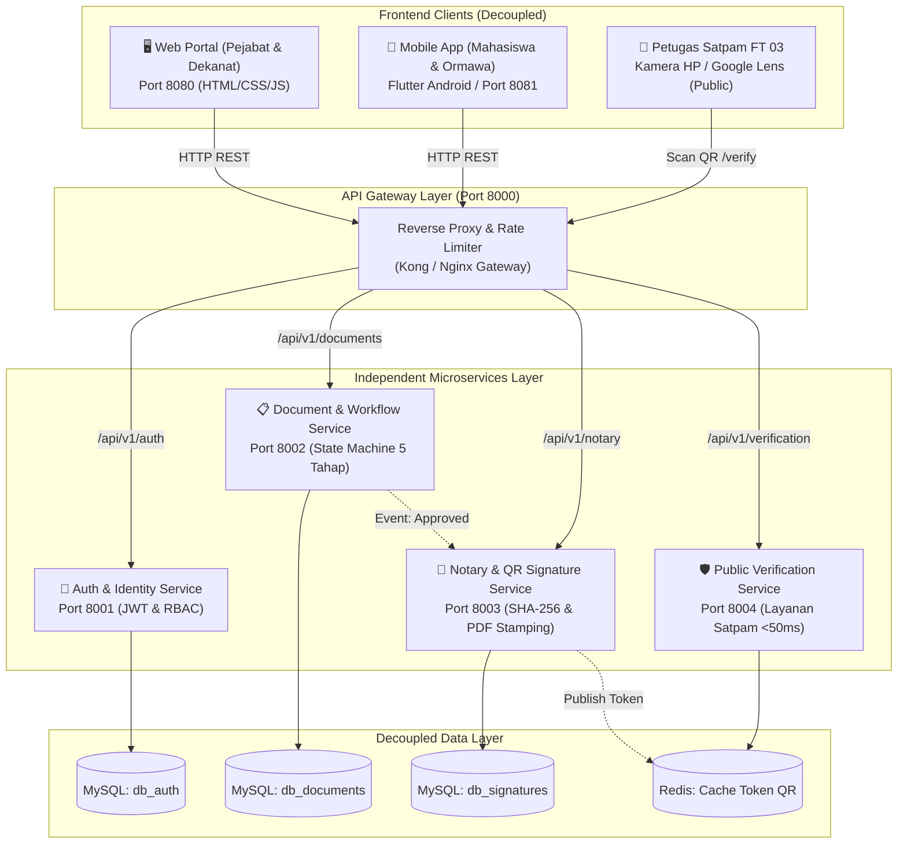

# Arsitektur Microservices - ValidIn UNTIDAR
### Sistem Pengesahan Dokumen Digital & Validasi Notarial Kampus

Dokumen ini mendefinisikan arsitektur **Microservices Terdistribusi** untuk sistem ValidIn, memisahkan domain fungsional menjadi layanan-layanan independen (*decoupled services*) yang berkomunikasi melalui **API Gateway**.

---

## 🏛️ Topologi Arsitektur Microservices



---

## 📦 Batasan Layanan (Service Boundaries)

| Microservice | Port | Domain Tanggung Jawab | Teknologi / Stack |
| :--- | :---: | :--- | :--- |
| **API Gateway** | `8000` | • *Single Entrypoint* routing lalu lintas klien.<br>• Penanganan CORS, validasi Bearer Token JWT.<br>• *Rate limiting* & proteksi DDoS pada endpoint publik. | Nginx / Envoy / Node.js Express Gateway |
| **Auth & Identity Service** | `8001` | • Autentikasi 4 pejabat UNTIDAR & akun mahasiswa.<br>• Penerbitan token akses (JWT / Sanctum).<br>• Manajemen hak akses peran (RBAC). | Laravel 11 / Node.js |
| **Document & Workflow Service** | `8002` | • *State Machine* 5 tahap alur persetujuan.<br>• Pengajuan draf surat oleh Sekretaris Panitia.<br>• Fitur perbaikan revisi langsung (*in-place edit*).<br>• Pencatatan disposisi pejabat resmi. | Laravel 11 / PHP 8.2 |
| **Notary & Signature Service** | `8003` | • Perhitungan sidik jari integritas berkas (SHA-256).<br>• Pembuatan token unik UUID v4 untuk QR Code.<br>• *Stamping* stempel resmi & QR ke berkas fisik PDF. | Python / Go / PHP Imagick |
| **Public Verification Service** | `8004` | • Layanan publik tanpa autentikasi khusus Satpam.<br>• Pencarian data izin berbasis UUID token QR.<br>• Penyiapan data instruksi pembukaan pintu gedung FT 03.<br>• *Ultra-low latency* (<50ms) menggunakan Redis cache. | Go / Node.js / Laravel Cache |

---

## 🔄 Alur Komunikasi Antar-Layanan (Workflow Sequence)

1. **Pengajuan Surat:**
   - Mahasiswa/Sekretaris mengajukan izin via **Mobile App** $\rightarrow$ `APIGW` $\rightarrow$ `Document Service`.
   - Status awal: `menunggu_pelaksana`.
2. **Persetujuan Berjenjang:**
   - Pejabat menyetujui via **Web Portal** $\rightarrow$ `Document Service` memverifikasi token pejabat ke `Auth Service`.
   - Alur bergerak: Ketua Pelaksana $\rightarrow$ Ketum HIMATIF $\rightarrow$ Pembina $\rightarrow$ Wadek I FT.
3. **Pengesahan & Stempel Notarial:**
   - Saat Wadek I FT mengesahkan berkas, `Document Service` memicu `Notary Service`.
   - `Notary Service` membangkitkan digest SHA-256, membuat token QR `7e4b2d19-...`, menyematkan stempel visual Dekanat, lalu menyimpan token ke `Public Verification Service` (Redis cache).
4. **Validasi Satpam di Lapangan:**
   - Mahasiswa membuka **Mobile App** (Pass QR) $\rightarrow$ Satpam memindai dengan kamera HP.
   - Kamera membuka URL: `https://validin.ft.untidar.ac.id/verify/{uuid}`.
   - `Public Verification Service` merespons dalam <50ms menampilkan instruksi pembukaan gedung FT 03.

---

## 🚀 Struktur Direktori Microservices

```
ValidIn/
├── docs/                        # Dokumentasi arsitektur & kontrak API
│   ├── MICROSERVICES_ARCHITECTURE.md
│   ├── API_CONTRACT.md
│   ├── ERD.md
│   └── SRS.md
├── web/                         # Frontend 1: Web Portal Desktop Pejabat (Port 8080)
├── mobile/                      # Frontend 2: Mobile App Mahasiswa / Flutter (Port 8081)
│   ├── lib/                     # Kode Flutter Android
│   ├── pubspec.yaml
│   └── index.html               # Mobile Web Standalone Runner
└── backend/                     # Backend Microservices Layer
    ├── docker-compose.yml       # Orkestrasi seluruh container microservices
    ├── gateway/                 # Konfigurasi Nginx API Gateway (Port 8000)
    └── services/
        ├── auth-service/        # Port 8001
        ├── document-service/    # Port 8002
        ├── notary-service/      # Port 8003
        └── verification-service/# Port 8004
```

---

## 🐳 Cara Menjalankan Microservices (Docker Compose)

```bash
cd backend
docker compose up -d
```
Seluruh service, database, dan gateway akan otomatis aktif:
- Gateway: `http://localhost:8000`
- Web Portal: `http://localhost:8080`
- Mobile Client: `http://localhost:8081`
