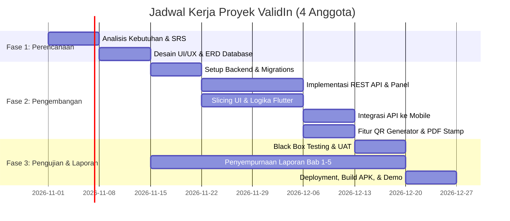

# Pembagian Tugas & Tanggung Jawab Tim (4 Anggota) - ValidIn

Dokumen ini mengatur pembagian tugas, peran, tanggung jawab, dan hasil kerja (*deliverables*) untuk tim pengembang proyek **ValidIn** (4 Anggota) dalam mata kuliah Sistem Web dan Seluler Lanjut.

---

## 👥 Matriks Peran & Tanggung Jawab

| No | Peran Anggota | Fokus Utama | Deliverables (Hasil Kerja) |
| :-: | :--- | :--- | :--- |
| **1** | **Ketua Kelompok & System Analyst** | • Manajemen proyek dan *timeline* (Gantt Chart). • Analisis kebutuhan (5 Whys, SRS, MoSCoW, ISO 25010). • Desain alur sistem (*State Machine*, *Use Case*, *Activity Diagram*). • Perancangan *wireframe* & desain UI/UX di Figma (Mobile & Web). • Memimpin koordinasi rapat mingguan dan presentasi di depan dosen. | • Gantt Chart Proyek • Dokumen SRS & Use Case • Mockup Desain UI/UX Figma • Slide Presentasi & Pengawalan Demo |
| **2** | **Backend Developer (Laravel & Database)** | • Perancangan basis data (ERD, Migrations, Seeders MySQL). • Membangun RESTful API dengan Laravel 11 & Laravel Sanctum. • Mengembangkan alur logika persetujuan (*document state machine*). • Mengimplementasikan generator QR Code unik dan penyematan (*stamping*) ke berkas PDF. • Mengembangkan panel web dashboard untuk Ketua Organisasi & Dosen Pembina (Blade/Livewire). | • Source code Laravel API & Web Panel • Skema Database & Migrations • Modul QR Code Generator & PDF Stamping • Endpoint Verifikasi Publik |
| **3** | **Mobile Developer (Flutter Specialist)** | • Inisialisasi arsitektur proyek Flutter (Android target). • Mengimplementasikan antarmuka mahasiswa (*slicing* UI dari desain Figma). • Integrasi REST API (Login, Unggah PDF multipart, Riwayat dokumen). • Membuat komponen visual pelacakan status (*stepper timeline tracking*). • Mengintegrasikan *in-app PDF Viewer* dan fitur unduh dokumen sah. • Mengompilasi dan menguji file rilis APK di perangkat Android fisik. | • Source code aplikasi Flutter • Berkas rilis APK Android siap install • Komponen interaktif *status tracking* |
| **4** | **QA Tester & Technical Writer (Notulis)** | • Menyusun laporan akhir proyek secara bertahap (Bab 1 s/d Bab 5). • Merancang dokumen skenario pengujian (*Test Cases Black Box Testing*). • Membuat dokumentasi dan koleksi API (Postman Collection / Swagger). • Melakukan pengujian fungsional aplikasi (API, Web Dashboard, Mobile, dan Pemindaian QR). • Mencatat notulensi evaluasi progres mingguan dan masukan dosen pembimbing. | • Laporan Akhir Proyek Lengkap (Bab 1-5) • Dokumen *Test Cases* & Laporan Hasil Pengujian (UAT) • Koleksi Postman API (+ Environment) • Notulensi Bimbingan Dosen |

---

## 🔄 Matriks RACI (Responsible, Accountable, Consulted, Informed)

- **R (Responsible):** Pelaksana tugas utama.
- **A (Accountable):** Penanggung jawab akhir keberhasilan tugas.
- **C (Consulted):** Pihak yang diajak berdiskusi/memberi masukan.
- **I (Informed):** Pihak yang menerima pembaruan hasil kerja.

| Aktivitas Proyek | Ketua / Analis | Backend Dev | Mobile Dev | QA / Tech Writer |
| :--- | :---: | :---: | :---: | :---: |
| Analisis Masalah & Kebutuhan (SRS) | **A / R** | C | C | R |
| Desain Wireframe & Mockup UI/UX | **A / R** | I | C | I |
| Perancangan Skema Database (ERD) | C | **A / R** | I | I |
| Pembuatan REST API & State Machine | I | **A / R** | C | C |
| Pembuatan QR Code & PDF Stamping | I | **A / R** | I | C |
| Pembuatan Web Dashboard Panel | C | **A / R** | I | I |
| Pembuatan Aplikasi Mobile (Flutter) | C | C | **A / R** | I |
| Integrasi API ke Mobile | A | R | **R** | I |
| Pengujian Fungsional (Black Box / UAT) | C | C | C | **A / R** |
| Penyusunan Laporan Akhir Bab 1-5 | C | I | I | **A / R** |
| Deployment & Kompilasi APK Demo | **A / R** | R | R | I |

---

## 📅 Rencana Kerja Mingguan (Milestone 1 Semester)

